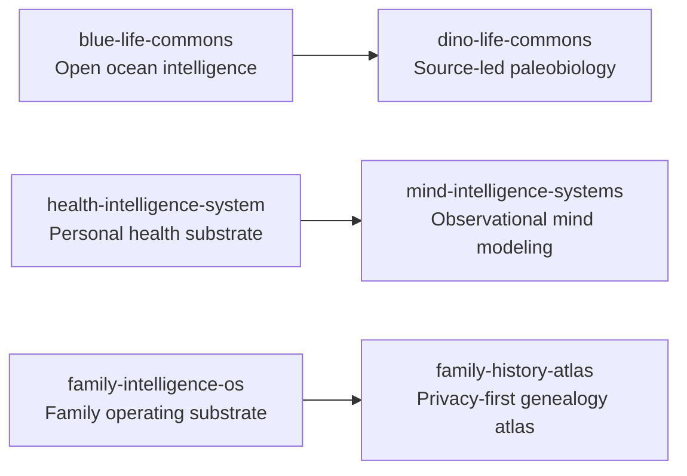

# Life Commons

Open-source knowledge commons across ocean intelligence, paleobiology, health, mind, and family history.

**Website:** [bluelifecommons.org](https://bluelifecommons.org) · **Ecosystem:** [Starlight Intelligence](https://github.com/Starlight-Intelligence) · [Starlight Systems](https://github.com/Starlight-Intelligence-Systems) · [Arcanea Labs](https://github.com/Arcanea-Labs) · [GenCreator](https://github.com/GenCreator-ai) · [FrankX](https://github.com/FrankX-AI)

---

## Overview

Life Commons stewarding open, source-attested knowledge systems for the living world and human flourishing: marine ecosystems, paleobiology, personal health tracking, reflective mind models, and privacy-first family history.

## System topology



## Flagship repositories

| Repository | Purpose | Link |
| :--- | :--- | :--- |
| [**blue-life-commons**](https://github.com/Life-Commons/blue-life-commons) | Open ocean intelligence commons documenting marine species, conservation zones, and field data. | [Website](https://bluelifecommons.org) |
| [**dino-life-commons**](https://github.com/Life-Commons/dino-life-commons) | Source-led paleobiology encyclopedia with specimen provenance, stratigraphy, and taxonomy. | [Website](https://dinolifecommons.org) |
| [**health-intelligence-system**](https://github.com/Life-Commons/health-intelligence-system) | Local-first personal health intelligence substrate for energy, sleep, and training logs. | [Website](https://bluelifecommons.org) |
| [**mind-intelligence-systems**](https://github.com/Life-Commons/mind-intelligence-systems) | SIP-conformant observational substrate for cognitive reflection and habit modeling (non-clinical). | [Website](https://bluelifecommons.org) |
| [**family-intelligence-os**](https://github.com/Life-Commons/family-intelligence-os) | Privacy-first operating substrate for household coordination and shared family archives. | [Website](https://bluelifecommons.org) |
| [**family-history-atlas**](https://github.com/Life-Commons/family-history-atlas) | Evidence-aware, local-first family tree and historical geography atlas. | [Website](https://bluelifecommons.org) |

## Quickstart

```bash
# Clone Blue Life Commons
git clone https://github.com/Life-Commons/blue-life-commons.git

# Clone Family History Atlas
git clone https://github.com/Life-Commons/family-history-atlas.git
```

## Engineering standards

Every repository in **Life Commons** follows the Starlight estate engineering contract:

1. **Draft-first pull requests**: Open pull requests in draft mode (`gh pr create --draft`). CI workflows run only when a pull request is marked ready for review or lands on `main`.
2. **Independent verification**: Maker harness and Checker harness must differ (`Maker-Harness` != `Checker-Harness`).
3. **Zero committed secrets**: Credentials live in local environment files or Infisical. Pre-commit and CI gates reject secret patterns.
4. **Editorial clarity**: Public documentation uses sentence case headings, concrete verbs, and verified metrics.

---

<sub>Maintained by <a href="https://github.com/frankxai">Frank Riemer (frankxai)</a> · Built on the <a href="https://github.com/Starlight-Intelligence-Systems/Starlight-Intelligence-System">Starlight Intelligence Protocol (SIP)</a></sub>
